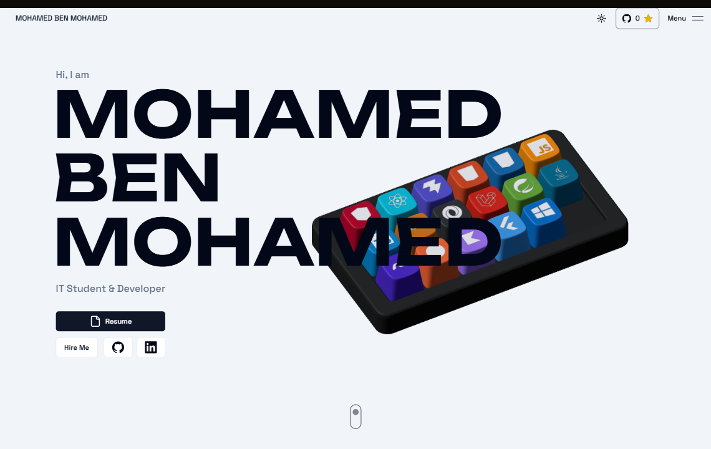
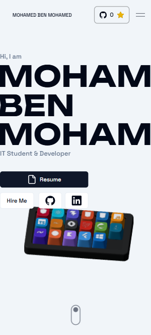
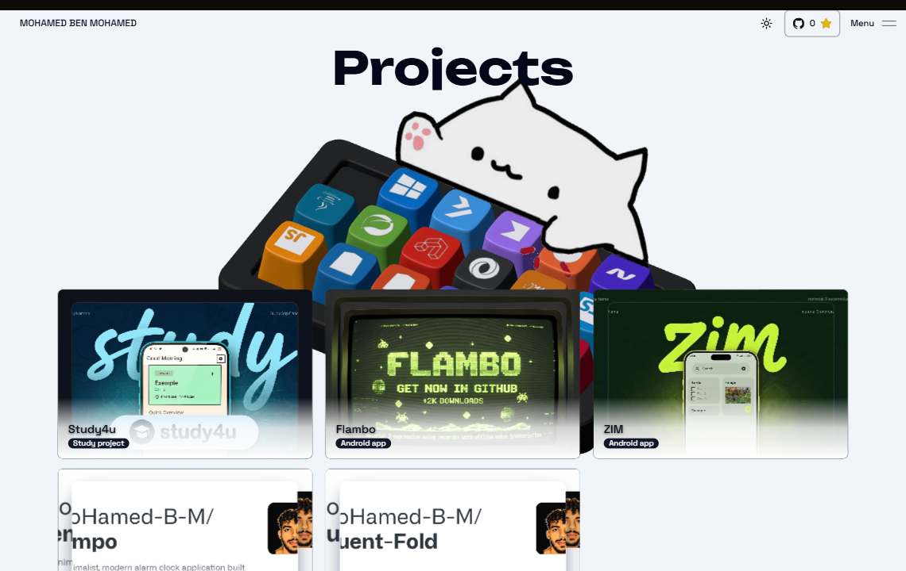
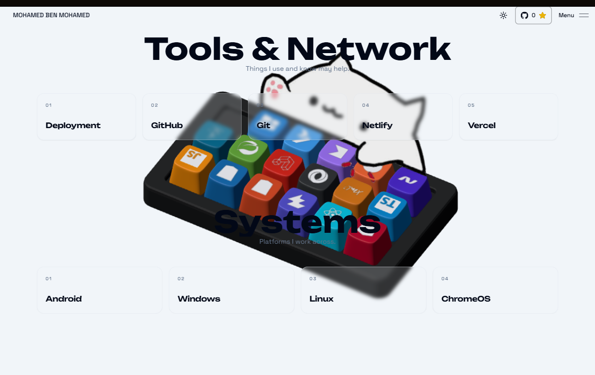
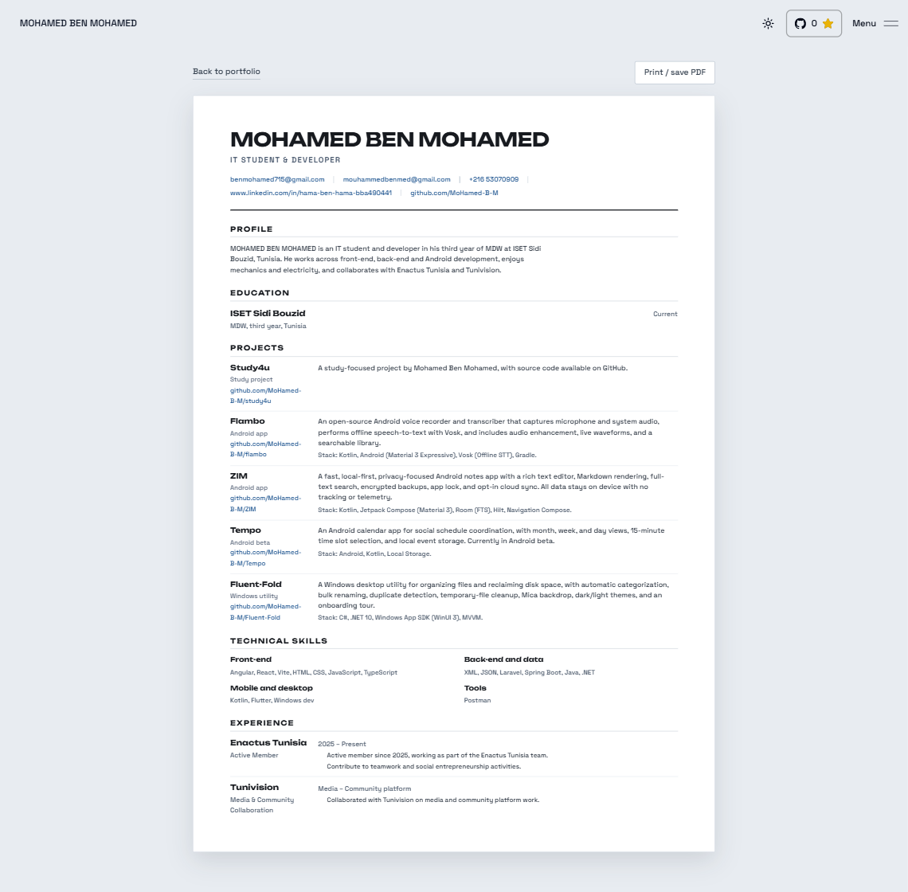
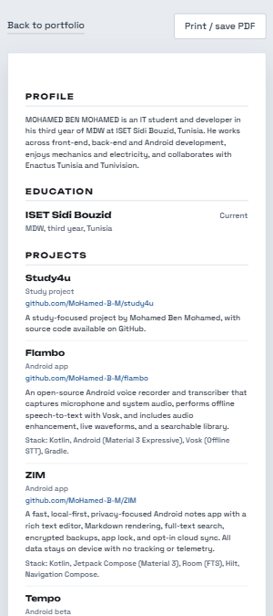

# MOHAMED BEN MOHAMED — Portfolio

IT Student & Developer. Third-year MDW student at ISET Sidi Bouzid, working across front-end, back-end, and Android development.

[Live site](https://portfolio-seven-gamma-tq68uxztjv.vercel.app) · [Online CV](https://portfolio-seven-gamma-tq68uxztjv.vercel.app/resume) · [GitHub repository](https://github.com/MoHamed-B-M/Portfolio) · [LinkedIn](https://www.linkedin.com/in/hama-ben-hama-bba490441/)

[](https://github.com/MoHamed-B-M/Portfolio/stargazers)
[](https://github.com/MoHamed-B-M/Portfolio/network/members)
[](LICENSE)
[](https://nextjs.org)
[](https://pnpm.io)

[](https://vercel.com/new/clone?repository-url=https://github.com/MoHamed-B-M/Portfolio)

## Screenshots

Desktop home page:



Home page on mobile:



Projects section:



Tools, systems, testing, and interests sections:



Online CV:





These captures live in `public/assets/screenshots`. Project cards continue to use their repository or Open Graph thumbnails from `src/data/projects.tsx`.

## What is in this portfolio

- **Interactive 3D keyboard** built from the 17 technologies in `src/data/constants.ts`. Each key reveals a skill title and description on hover, focus, or press.
- **Hero and skills sections** with GSAP and Framer Motion scroll/hover/reveal animation.
- **Projects** with exact names, descriptions, stacks, repository links, and original thumbnails. Project cards open a README modal rendered with GitHub dark markdown styling and syntax highlighting.
- **Tools & Network** section with Deployment, GitHub, Git, Netlify, and Vercel.
- **Systems** section with Android, Windows, Linux, and ChromeOS.
- **Testing** section with Unit, Integration, and End-to-end.
- **Interests** section with Mechanics, Electricity, and Arduino & robotics.
- **Online CV** at `/resume`, generated from portfolio data. It replaces the old PDF viewer and provides a browser Print / Save PDF action.
- **Contact form** delivered through Resend.
- **Blog** routes driven by MDX content under `content/blogs`.
- **Optional realtime features**: live cursors, presence, and chat when `NEXT_PUBLIC_WS_URL` is configured.
- **Light and dark themes**, responsive layouts, and reduced-motion handling.

## Tech stack

| Layer | Technologies |
|---|---|
| Framework | Next.js 16.2.2, React 19.2.4, TypeScript |
| Styling | Tailwind CSS, shadcn-style UI primitives, CSS Modules |
| Animation | GSAP, Framer Motion, Lenis |
| 3D | @chibi3d/runtime, Three.js, React Three Fiber |
| Markdown | react-markdown, remark-gfm, rehype-highlight, github-markdown-css |
| Email | Resend |
| Optional realtime | Socket.IO client |
| Analytics | Umami, Next.js third-party scripts |
| Package manager | pnpm 11.20.0 |

## Getting started

### Prerequisites

- Node.js 20.9 or newer
- pnpm 11.20.0

### Install and run

```bash
git clone https://github.com/MoHamed-B-M/Portfolio.git
cd Portfolio
pnpm install
cp .env.example .env.local
pnpm dev
```

Open `http://localhost:3000`.

### Environment variables

| Variable | Required | Purpose |
|---|---|---|
| `RESEND_API_KEY` | Yes at runtime | Sends messages from the contact form. The app builds without it, but the API returns a clear error until it is set. |
| `NEXT_PUBLIC_WS_URL` | No | Enables live cursors, presence, and chat when a realtime server URL is provided. |
| `UMAMI_DOMAIN` | No | Overrides the Umami script URL for self-hosted analytics. |
| `UMAMI_SITE_ID` | No | Enables the public Umami analytics script. |
| `UMAMI_DEPLOY_SITE_ID` | No | Records deployment hostnames through `/api/collect`. |
| `NEXT_PUBLIC_LEGACY_HOST` | No | Shows a one-time "we moved" notice when the old host is detected. |

## Code checks

```bash
pnpm lint
pnpm typecheck
pnpm build
```

The production build does not require `RESEND_API_KEY`; set it in production so the contact form can send email. Next.js 16 does not run ESLint during builds, so run `pnpm lint` separately. Blog posts require frontmatter with `title`, `summary`, and `publishedAt` in `YYYY-MM-DD` format; optional fields are `image`, `author`, and `tags`.

## Project structure

| Path | Purpose |
|---|---|
| `src/app/page.tsx` | Home page composition and section order. |
| `src/app/resume/` | Online CV page, print action, and print stylesheet. |
| `src/components/sections/` | Hero, skills, experience, projects, toolkit, and contact sections. |
| `src/components/project-readme.tsx` | Sanitized GitHub-flavored README renderer with dark styling and code highlighting. |
| `src/components/scrolling-preview.tsx` | Card preview with wallpaper fallback and hover pan behavior. |
| `src/data/config.ts` | Name, role, bio, emails, site, GitHub, LinkedIn, and metadata. |
| `src/data/constants.ts` | 17 skills, keyboard settings, and Enactus/Tunivision experience. |
| `src/data/projects.tsx` | Project names, descriptions, stacks, thumbnails, repository links, and README content. |
| `public/assets/screenshots/` | Local screenshots used in this README. |
| `public/assets/keyboard/logos/white/` | Keyboard-only white SVG logos used by the 3D scene. |

## Customize it

Central identity and contact details live in [`src/data/config.ts`](src/data/config.ts). Update `config.site` to the real deployed origin before publishing.

| File | Change |
|---|---|
| `src/data/projects.tsx` | Project titles, summaries, stacks, repository links, thumbnails, and README content. |
| `src/data/constants.ts` | Skill labels, descriptions, keycap colors, keyboard icons, and experience entries. |
| `src/components/sections/toolkit.tsx` | Tools & Network, Systems, Testing, and Interests items. |
| `src/app/resume/resume-view.tsx` | CV content and section order. |
| `public/assets/screenshots/` | Replace the local captures with updated screenshots. |
| `public/assets/keyboard/logos/white/` | Keyboard-only SVG logos. The skills grid keeps the original colorful SVGs. |

### 3D keyboard

Configure each skill in `SKILLS` inside [`src/data/constants.ts`](src/data/constants.ts):

- `keyboardColor`: keycap color, such as `#ff9408`.
- `keyboardIcon`: image URL or local path under `public/assets/keyboard/logos/`.
- `label` and `shortDescription`: text shown when a key is inspected.
- `shortcut`: optional `KeyboardEvent.code`, such as `KeyQ`. Keep shortcuts unique; defaults follow QWERTY letter order.

Keys follow the order of `SKILLS`. Rows adjust automatically to the number of skills.

### Online CV

`/resume` is the source of truth for the CV. It reads profile data from `config.ts`, skills and experience from `constants.ts`, and projects from `projects.tsx`. The Resume button in the hero links to this route. Use the page's **Print / save PDF** button to export a clean A4 document.

## Realtime features

Realtime features are optional and require a separate backend. They activate automatically when `NEXT_PUBLIC_WS_URL` is set. Without it, the portfolio works as a static site. The backend API is intentionally private.

## Deployment

Live deployment: [portfolio-seven-gamma-tq68uxztjv.vercel.app](https://portfolio-seven-gamma-tq68uxztjv.vercel.app)

1. Push this repository to GitHub.
2. Connect it to [Vercel](https://vercel.com).
3. Add the environment variables above in the Vercel dashboard.
4. Deploy. Vercel handles builds and automatic deployments on every push.

A deployed copy reports its own hostname once per browser through the analytics collector; it does not send visitor, page, or referrer data.

## License

MIT. See [LICENSE](LICENSE).

Maintained at [MoHamed-B-M/Portfolio](https://github.com/MoHamed-B-M/Portfolio).
